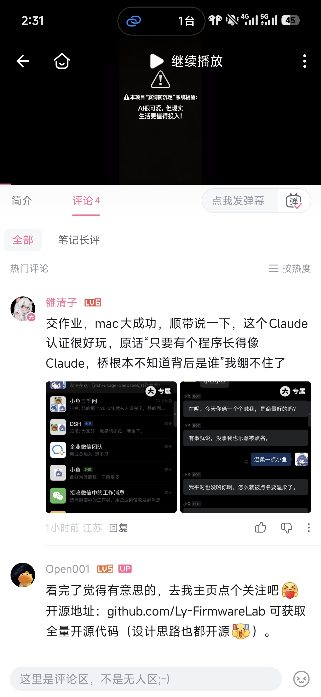
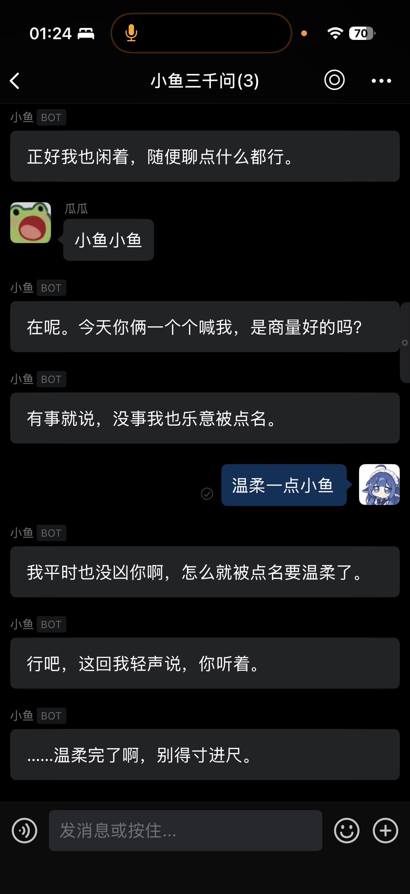

# 真实用户反馈

**这里放的是别人用出来的结果，不是我们自己的验收。**

| 日期 | 来源 | 说的是什么 |
|---|---|---|
| 2026-11-15 | 视频评论区 · 雛清子 | 自述在 **macOS** 上接入成功，附他自己的运行截图 |
| 2026-11-13 | 视频评论区 · Conquer-月 | 接好之后，机器人在聊天里能发 AI 生成的贴图 |

> ⚠️ **口径**：每一条都**照录原话、直出原意**，不改字、不裁剪语境。
> 用户说自己成功了，就是"用户说自己成功了" —— 我们不替他们下结论，
> 也不把别人的回执写成我们的实测。

---

## 2026-11-15 · macOS 上跑起来了

> 用户「雛清子」，在视频评论区交作业

> 交作业，mac 大成功，顺带说一下，这个 Claude 认证很好玩，原话"只要有个程序长得像 Claude，桥根本不知道背后是谁"我绷不住了

**后面那句是他自己撞出来的结论。** 桥只认"一次能跑命令的执行"这件事，不认底下是谁 ——
这正是 [联邦式中枢](../federation.md) 想要的形状：入口、内核、执行面各管一段，
**换哪一段都不需要动另外两段**。

他配的两张缩略图，原图是这样 —— 他自己的企微：

第一条消息里那句"装法在这"，是他把接入说明丢进群里。
同一台机器上还挂着另一个 harness 的群（`DSH`） —— 和
[多 harness 并存](../field-reports/README.md) 描述的情形一致。

**这一条能说明的**：有人照着同一份文档、在自己的机器上、换了一个操作系统把它搭起来了，
而且跑通之后是**日常在用** —— 私聊、群聊、会话列表都是活的。

**这一条不能说明的**：我们没在 macOS 上复核过，也没看过他的代码。
系统相关的那几处（开机自启、单实例、杀进程树）本仓写的是 Windows 实现，
macOS 上要按各自系统替换 —— 怎么替换，见教程
[§8 的「6 个适配点」](../claude-code-wecom-guide.md)。

---

## 2026-11-13 · 聊天里的 AI 贴图

> 用户「Conquer-月」交的作业

左边是他自己的企微会话列表，右边是聊天里收到的一条 AI 生成的贴图。

**这一条能说明的**：接好之后，机器人不只是回文字 —— 图片消息这条路也是通的。

> 图中对话与昵称均来自用户在评论区**公开发布**的原文与原图，已获本人同意转载。
> 除第三张里一处与内容无关的客服头像做了打码外，未做其他裁剪或修改。