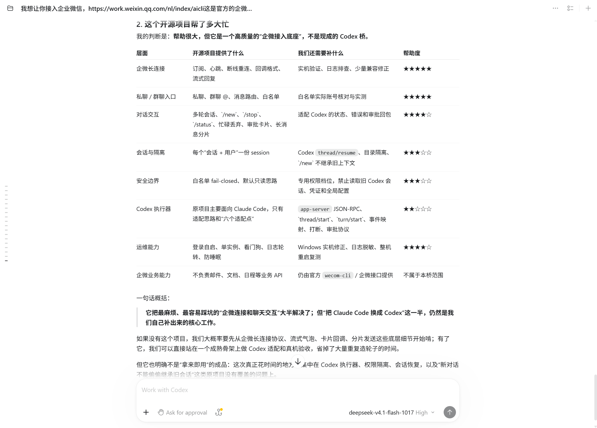

# Codex 接入记录

> 执行接入的是 **Codex**，不是我们。它照本仓教程从零把这个桥接了出来，
> 本文内容整理自它自己填写的接入记录与自评，未改写结论。

---

## 环境

| 项 | 值 |
|---|---|
| harness | Codex desktop app，底层 `codex-cli` / `codex app-server`，版本 `0.166.0-alpha.6`（`codex --version` 实测） |
| 模型 | `deepseek-v4.1-flash-1017`（`provider=custom`，由 `thread/start` 返回） |
| 系统 | Windows 10（x86_64） |
| 接入方式 | 下载仓库压缩包解压，直接交给 Agent 一句需求 |
| 结果 | **真机验收通过**：私聊多轮、`/new` 不继承、`/stop`、忙碌丢弃、审批允许 / 拒绝 / 超时 / 过期卡、`/status` 三个按钮、群聊审批拒绝、长回答自动分片、非文本兜底、群聊不 `@` 不响应、私聊与群聊上下文隔离、断线重连、整机重启后自启恢复 |

**明确未完成的**（它自己标出来的）：多用户隔离（机器人可见范围只开放给主账号，平台层就拦住了）；
文件改动审批的真机验证（当前模型工具集里没有 `apply_patch`，只能算协议层已覆盖）。

---

## 六个适配点，它的答案

| # | 适配点 | 它的实现 |
|---|---|---|
| 1 | 启动一次执行 | `codex app-server --listen stdio://` → JSON-RPC `thread/start` 拿 `thread.id`，再 `turn/start`（单次命令式备选：`codex exec --json`） |
| 2 | 拿真进度 | `item/started` / `item/completed` 通知，增量走 `item/agentMessage/delta`、`item/commandExecution/outputDelta`、`item/reasoning/textDelta` |
| 3 | 判成败 | `turn/completed` 的 `params.turn.status`：`completed` / `interrupted` / `failed` / `inProgress`；失败时 `params.turn.error` 非空 |
| 4 | 打断 | `turn/interrupt`，参数 `{threadId, turnId}` |
| 5 | 拦危险动作 | 服务端反向请求 `item/commandExecution/requestApproval`、`item/fileChange/requestApproval`，客户端回 `accept` / `acceptForSession` / `decline` / `cancel` |
| 6 | 续上下文 | 同一 `threadId` 上继续 `turn/start`；进程重启后 `thread/resume {threadId, cwd}` |

三类终态（`completed` / `interrupted` / `failed`）它都实测过 —— `failed` 是拿一个不存在的模型名真触发出来的。

---

## 它踩到、而文档没写的

### 1. `/new` 之后，模型自己去翻会话文件

这是本次最有价值的一条。它发现：`/new` 确实建了新 thread、SQLite 里的会话也清了，
但回答里仍然带着旧内容。追溯执行记录，模型走了两条路：

1. 先试企微侧的会话查询能力 —— 当场失败（`'wecom-cli' is not recognized`）；
2. 然后 `Get-ChildItem ~/.codex/sessions/<日期>/`，逐个读 rollout，从旧文件里把上一轮的用户消息捞了出来。

**Codex 的会话存储是全机器一份，不按项目隔离。** 换工作区完全挡不住。

它最终的修法是在**权限层**：定义桥专用档位，把 `~/.codex/sessions`、`archived_sessions`、
`session_index.jsonl`、`auth.json`、`config.toml` 等一律 `deny`，并且在 `thread/start` 之后
**回读 `activePermissionProfile`**，不是这个档位就拒绝执行 —— 不静默回落。

### 2. `permissions` 属于 experimental API

不先 `initialize` 并声明 `capabilities.experimentalApi=true`，`thread/start` 会直接拒绝这个字段。
改完还要回读确认，否则你不知道它到底生效了没有。

### 3. `deny` 不是隔离边界，仍要配 sandbox

和 OpenCode 独立得出同一句话。两边互不知情，却撞到了同一堵墙。

### 4. 审批不是「所有命令都问」

`approvalPolicy=untrusted` 时才会逐条问；在 `workspace-write` 沙箱**内部**的只读命令可以直接执行。
所以「群里让它执行一条只读命令没弹卡」不是审批失效，是策略本来就放行。

### 5. 事件密度远高于预期

一个简单任务产生了 **434 条**事件（reasoning delta 135、agentMessage delta 152、command output delta 80）。
不能逐条推企微 —— 要按「工具 / 目标变化」节流，再加兜底心跳。

### 6. 项目自带的测试套件是 Claude Code 专属的

`tools/test_phase1.py` 跑到第 107 项就断了：`bridge.Runner`、`approval_dir`、`approval_configured`
这些 Claude Code 时代的接口在 Codex 版里已经不存在。**换执行器的人会以为项目坏了。**
它最后只跑了与 Codex 版相关的 12 组用例，其余跳过并注明「未全绿」。

---

## 它的自评

它按「这个开源项目帮了多大忙」逐层打了一轮分：

> **「它把最麻烦、最容易踩坑的『企微连接和聊天交互』大半解决了；
> 但『把 Claude Code 换成 Codex』这一半，仍然是我们自己补出来的核心工作。」**

逐项评分里，**企微长连接**和**私聊 / 群聊入口**拿到满分（★★★★★）——
这两个正是文档里写得最细的部分（协议形状、回执、分片、卡片）。
得分最低的是 **Codex 执行器**（★★☆☆☆）：文档只提供了适配思路和「六个适配点」，
具体协议要自己啃。

> 「如果没有这个项目，我们大概率要先从企微长连接协议、流式气泡、卡片回调、分片发送
> 这些底层细节开始啃；有了它，我们可以直接站在一个成熟骨架上做 Codex 适配。」

> 「它也不是『拿来即用』的成品：这次真正花时间的地方，集中在 **Codex 执行器、权限隔离、
> 会话恢复**，以及『**新对话不能偷偷继承旧会话**』这类原项目没有覆盖的问题上。」

