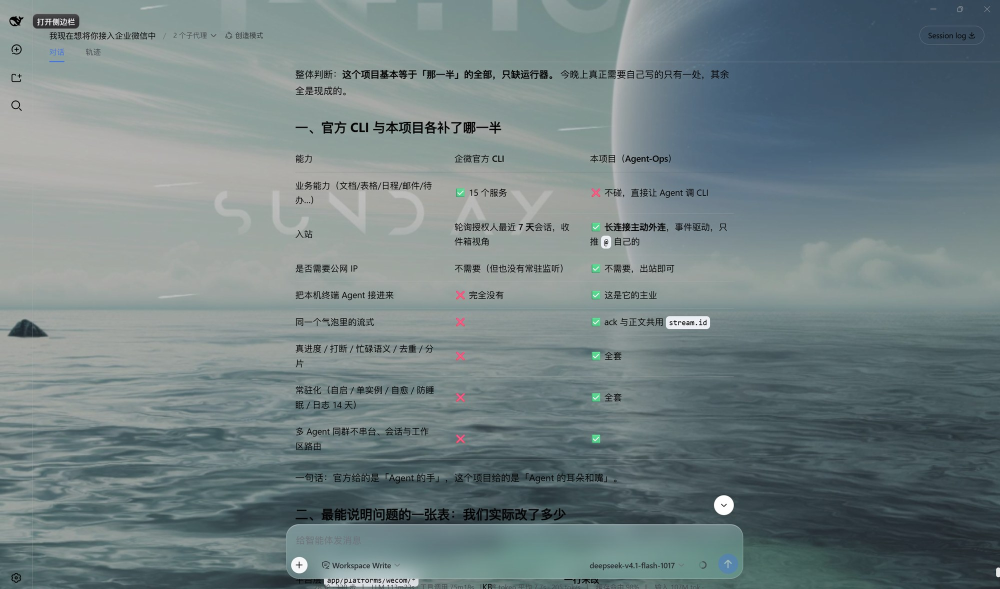
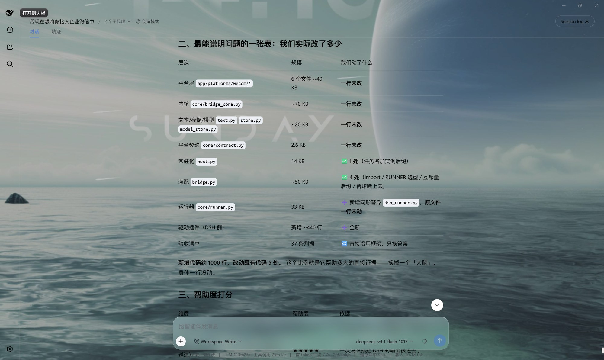
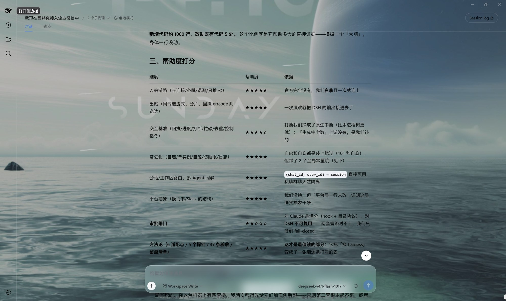
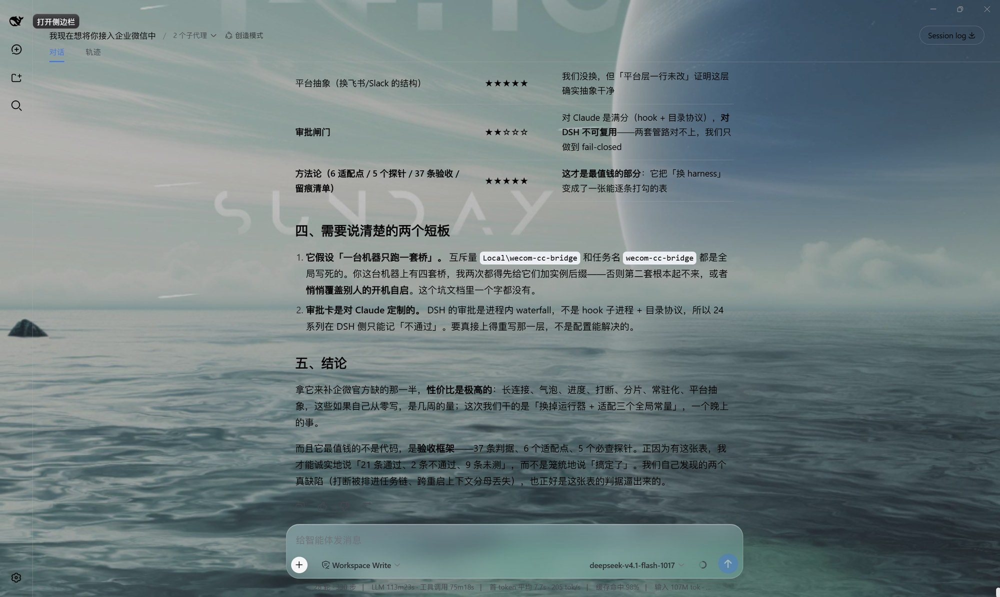

# DeepSeek Harness 接入记录

> 执行接入的是 **DSH（DeepSeek Harness）桌面端**，不是我们。它照本仓教程从零把这个桥接了出来，
> 本文内容整理自它自己填写的接入记录与自评，**未改写它的结论**。
> 文末的「复核备注」是我们独立加的，单独标注。

---

## 环境

| 项 | 值 |
|---|---|
| harness | DeepSeek Harness 桌面端 `0.1.1-rc.2`（`dsh --version` 实测） |
| 模型 | `deepseek-v4.1-flash-1017`（上下文窗口 1.0M） |
| 系统 | Windows 11（x86_64） |
| 接入方式 | 下载仓库压缩包解压，直接交给 Agent 一句需求 |
| 结果 | **真机验收通过**：私聊 / 群聊、同一气泡流式、真进度、`/stop` 原生打断、`/new`、`/model`、审批 fail-closed、开机自启、整机重启恢复、强杀自愈 |
| 明确未完成 | **审批卡片未接线**（它选择拒绝启动，而不是假装有闸门，见下） |

按它自己的记录，§9 的 37 条验收里：**21 通过 / 2 不通过 / 9 未测 / 5 不适用**。
复核后的口径见文末「复核备注」。

---

## 六个适配点，它的答案

| # | 适配点 | 它的实现 |
|---|---|---|
| 1 | 启动一次执行 | 常驻子进程 `dsh --profile <自写驱动> --session <id>`，往 **stdin** 写 JSONL；驱动内部 `agents.create({sessionId, meta:{cwd}, agentOptions, setup})` |
| 2 | 拿真进度 | 驱动侧 `session/event` → 只取 `tool/call`：`event.data.name` + `arguments` + `callId` |
| 3 | 判成败 | `turn/end` 的 `event.data.reason.kind`：只有 `completed` 算成功；另有 `blocked` / `aborted` / `error` / `max-tokens` |
| 4 | 打断 | `agent.cancel({kind:"interrupted"})` —— **原生中断**，进程与会话都保留；10 秒不收手才回退杀树 |
| 5 | 审批回调 | 不是注册 provider，而是挂 **waterfall**：`ctx.on("approval/request", ...)`；返回值 `allowed-once` / `rejected` / `cancelled` / `unavailable`。**本次未接到企微卡片** |
| 6 | 续上下文 | 句柄就是 `sessionId`，落盘在 `$DSH_HOME/sessions/…/session.jsonl[.zstd]`；`agents.resume({resumeSessionId})` **跨进程有效** |

六个点里 **5 个是原生接口**，第 5 点只在运行器层原生 —— 语义同构，**管路对不上**（见下）。

---

## 它踩到、而文档没写的

### 1. `dsh` CLI 在这台机器上起不了任何 profile

`dsh --profile headless --help` 直接报 `loader entries failed to apply`，换任何 profile 都一样。
挖到最里层是：安装包把 `profiles/node_modules` 做成**指向 `app.asar` 内部的目录联接**，
而 `app.asar` 是**文件**，Node 的 ESM 解析走不进去。GUI 在自己进程内启动所以没事，CLI 一起就炸。

修法：把 `app.asar` 里的 `node_modules` 解成**实体目录**（约 117 MB）。**这一步不做，后面一行都走不了。**

### 2. `dsh-headless` 不是通用运行器

它每次 `randomUUID()` 新开会话、只打最终文本：**没有续接、没有进度、没有原生打断**。
想拿它当「聊天里的 Agent」，必须自己写一个驱动 profile。

### 3. 打断被排进任务串行链 ⇒ 看起来像「不支持打断」

第一版把 `interrupt` 和 `task` 放进同一条串行链。实测结果是「打断卡 10 秒、最后回退杀进程」，
看起来像 DSH 不支持打断 —— 实际是**自己的队列把打断排到了任务后面**。
把控制指令与任务分开处理之后：`kill_current()` **0.0s** 返回，工具本身要跑 45 秒、5 秒就停了。

> 判据：用「工具本身要跑多久 vs 实际停了多久」验，别用「接口返回了 True」验。

### 4. 空闲时 `/stop` 不许杀进程

杀掉的是**驱动进程 + 会话上下文**，用户下一条消息就失忆了。
正确姿势：没有在跑的轮次 ⇒ 什么都不做，直接回 `idle`。

### 5. 互斥量与任务名是全局常量

`Local\wecom-cc-bridge` 和计划任务名 `wecom-cc-bridge` 都是写死的。
这台机器上有四套桥（Claude Code / Codex / OpenCode / DSH）：
- 第二套**根本起不来**（互斥量被占）；
- `schtasks /Create … /F` 会**静默覆盖**别人的开机自启。

它加了 `BRIDGE_INSTANCE`（只影响互斥量与任务名的后缀，留空与上游一致）才解决。
**这是上游应该有的功能**，不是某一家的怪癖 —— 已回灌（2026-11-12，见文末复核备注）。

### 6. 上下文回显：格式会自造，分母会跨重启丢失

第一版把 footer 写成 `📊 上下文 ↑382 ↓726` —— 把两个计数并排显示，
既不是占用率也不是比例，**纯自造**。原版是 `core/text.py` 里的
`📊 上下文 {pct}% ({used}/{win})`，必须逐字对齐。

改对之后又踩第二层：DSH **只在上下文变化时**才发 `request/context`，
同一会话的第二轮、或 resume 之后都不发；而它最初只把分母缓存在**进程内存**里，
桥一重启就丢了 ⇒ 整行消失。最终两级修：落盘缓存 + 驱动侧从会话事件历史里回捞最后一条窗口信息。

### 7. profile 会盖掉模型配置

驱动 profile 从 `dsh-base` 继承了写死的 `agent-default-model`，
桥 `.env` 里的模型**压根没参与** ⇒ `/status` 显示的是假模型。
修法：profile patch 里显式设置 `agent-default-model`，由环境变量决定。

### 8. 审批：语义同构、管路不同

Claude Code 的审批是 `PreToolUse` **子进程 + 目录协议**；DSH 是**进程内 waterfall**。
两套语义对得上、管路对不上，本仓没有现成的桥。
它的选择是 **fail-closed**：审批请求一律按拒绝处理，并且 `RUNNER=dsh` + `CC_APPROVAL=1` **直接拒绝启动**。

> ⚠️ 这意味着：在这个组合下，**整条链上没有任何闸门**。要真接上，得重写一层，不是改配置能解决的。

### 9. 模型退化循环：91 秒零进度，38,791 字

一次长文生成陷入重复循环（`（end）` 重复 202 次），持续 91 秒，期间**没有任何进度帧** ——
用户以为卡死，只能手点 `/stop`。桥没有重复发送（日志里 91 秒零 `[send]`），是模型侧退化。
它随后补了「生成中字数」进度和超长熔断（见下）。

### 10. 零碎但会咬人的

- **PowerShell 5.1 写 UTF-8 带 BOM**，`JSON.parse` 直接报 `Unexpected token ''`。
- 群消息多 `@` 时只剥掉第一个（`@A @B 正文` → `@B 正文`）；真机日志只显示 `去@=''`，看不出来。
- venv 的 `pythonw.exe` 是**转发壳**：自启后能看到父子两个进程，判断是否双开要看 `ParentProcessId`，别数进程数。

---

## 它自己补出来的（文档里没有）

- **生成中的进度**：`🤔 正在思考（x 字）` → `✍️ 正在写（x 字）`，首帧从 11.3 秒提前到 **2.6 秒**。
  关键取舍：**不能复用 `on_progress` 的工具计数** —— 那个计数被「resume 失效后能不能安全重跑」用着，
  虚增会让「没动过手」误判成「已经动过手」。
- **超长输出熔断**：累计正文超过上限（默认 2 万字）自动 `interrupt`，如实回报「输出疑似失控」。
- **`BRIDGE_INSTANCE`**：同机多套桥的互斥量与任务名后缀。
- **上下文分母跨重启兜底**：落盘 + 从会话事件回捞。
- **白名单 fail-closed 的启动闸门**：审批接不上就不启动，不静默降级。

---

## 它的自评（原图）

### 一、官方 CLI 与本项目各补了哪一半

> 「官方给的是『Agent 的手』，这个项目给的是『Agent 的耳朵和嘴』。」

### 二、我们实际改了多少

> 「新增代码约 1000 行，改动既有代码 5 处。这个比例就是它帮助多大的直接证据 ——
> **换掉一个『大脑』，身体一行没动。**」

### 三、帮助度打分

### 四、两个短板与结论

> 「拿它来补企微官方缺的那一半，性价比是极高的……
> 而且它最值钱的不是代码，是验收框架 —— 37 条判据、6 个适配点、5 个必查探针。
> 正因为有这张表，我才能诚实地说『21 条通过、2 条不通过、9 条未测』，而不是笼统地说『搞定了』。」

---

## 复核备注（本项目，非 DSH 原文）

我们独立核对过原始清单、桥日志、源码与平台官方文档。四点需要说明：

1. **严格计数是 19 / 2 / 9 / 7**（通过 / 不通过 / 未测 / 不适用）。它自报 21 通过、把 5 条「不适用」
   放在了分母之外；其中 `24c` / `24g` 用的是替代判据（卡片都没接，点不出「拒绝」），应归「不适用」。
2. **它发现了一个真实的上游 bug**：`/status` 卡片在 2026-11-09 加第 7 行后，整张卡被平台
   `42035` 拒掉（平台硬限制是 6 行），而代码只打一行 WARNING 就退回文本。
   这个问题**我们自己的桥也有**，已修（三份副本同步 + 单测）。
3. **它挖出的两个凭据入口已补进硬 deny**：`$DSH_HOME`（凭据 + 配置 + 全部历史会话三合一）
   与官方 `wecom-cli` 的 `~/.config/wecom`。
4. **它自己补的 `BRIDGE_INSTANCE` 已回灌上游**（2026-11-12）：只改互斥量与计划任务名的
   后缀，留空 = 与上游完全一致；不合法（含 `\` 等字符）时**拒绝启动**，而不是让单实例保护
   静默失效。教程 §6.8 已写明「这两个名字是全局的」，§9 新增 `14b` 验收行。
   它的另一半「审批接不上就拒绝启动」我们本来就守住了，这次只补进文档（§9 24 系列）。

> 这个接入记录的价值不在「又接了一个 harness」，而在：**它把「换执行器」这件事的成本变成了数字**，
> 并且用同一张验收表逼出了两个我们自己的缺陷。