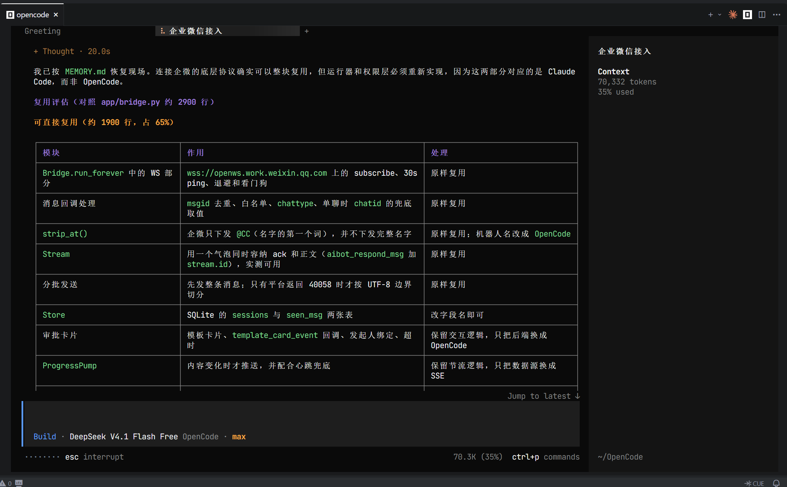
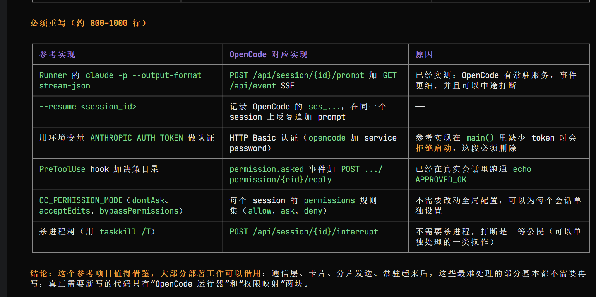

# OpenCode 接入记录

> 执行接入的是 **OpenCode**，不是我们。它照本仓教程从零把这个桥接了出来，
> 本文内容整理自它自己填写的接入记录与自评，未改写结论。

---

## 环境

| 项 | 值 |
|---|---|
| harness | OpenCode `2.2.5` |
| 模型 | DeepSeek V4.1 Flash 1017（免费额度耗尽后，换到同一模型的另一家接口继续） |
| 系统 | Windows（win32） |
| 接入方式 | 下载仓库压缩包解压，直接交给 Agent 一句需求 |
| 结果 | **真机验收通过**：私聊 / 群聊 / 流式气泡 / 审批卡 / `/stop` / `/new` / `/mode` / 分片 / 开机自启 / 关机重启后恢复 |

---

## 六个适配点，它的答案

| # | 适配点 | 它的实现 |
|---|---|---|
| 1 | 启动一次执行 | 常驻 `opencode serve` + `POST /api/session/{id}/prompt`（HTTP Basic，用户名固定 `opencode`） |
| 2 | 拿真进度 | `GET /api/event`（SSE）：`session.tool.called` / `session.tool.progress` / `session.text.delta` |
| 3 | 判成败 | 由事件流的最终状态判 —— 它没有找到一个单一的「终态字段」 |
| 4 | 打断 | `POST /api/session/{id}/interrupt` → `{"interrupted": bool}` + `session.execution.interrupted` |
| 5 | 拦危险动作 | `permission.asked` 事件 → 审批卡 → `POST .../permission/{rid}/reply`（`once` / `reject`） |
| 6 | 续上下文 | 记 `ses_...` 会话句柄，在同一个 session 上继续追加 prompt |

---

## 它踩到、而文档没写的

### 1. `opencode run` 拿不到审批 —— 这是整个项目最大的岔路口

非交互模式下，权限规则里的 `ask` 会被**自动拒绝**：

```
permission requested ... auto-rejecting
```

**进程照常退出 0，不报错。** 看起来像「权限配错了」，其实是**用错了驱动方式**。
只有常驻服务端才会发 `permission.asked` 事件。

### 2. 事件流必须先订阅再触发

先发 prompt 再连 SSE，会丢掉开头的事件，而且**没有任何报错**。表现是「回答少了第一段」。

### 3. 权限规则是 last match wins

为了放行普通的读操作而追加的 `read * = allow`，会把默认的 `read *.env = ask` **整条盖掉** ——
等于把桥自己的 Bot Secret 交给模型。三档权限都要在**末尾**补回 deny。

### 4. `read` 的资源是相对路径，`grep` 的资源是正则

用绝对路径写 `read` 的 deny 不生效（绝对路径只用于 external path）。
更要命的是：`grep` 的权限资源是**正则**而不是路径，`read` 的 deny 根本管不到它。

> **结论：`deny` 不是隔离边界。** 它当场撤销了自己刚加的一个「禁止读自己日志」开关，
> 理由是不想制造虚假的安全感。

### 5. `/stop` 只管「执行」，不管「等审批」

任务卡在审批上时发 `/stop`，打断会返回 `interrupted: false`（服务端确实没有正在跑的执行步骤）。
更糟的是：那张没被点的卡片后来被点上「允许」，卡面更新成「已允许」，而实际回给模型的是 `reject` ——
**界面和事实相反**。它的修法是：`/stop` 时先作废所有待审批，再打断执行。

### 6. `/new` 只清上下文，不清日志

模型被问「我刚刚说了什么」时，会去读桥自己的日志，从记录里把上一轮重建出来。

---

## 它自己补出来、而文档里没写的

这几条最能说明「约定是可移植的」—— 它没有照抄，是自己重新想到了：

- **代次（epoch）**：`/new` 之后，正在跑的旧任务不许把旧会话句柄写回库，否则「清空」会被覆盖回去。
- **`kill_status` 三态**：`killed` / `canceled` / `idle` —— `interrupted: false` 不等于「没在跑」，
  也可能只是「在等审批」。
- **取消要连审批一起取消**（见上）。
- **答案落底**：本轮只要发过卡片，气泡就收口成「已完成，回答见下」，正文另发 —— 否则答案会写回卡片上方。
- **白名单 fail-closed**：留空直接拒绝启动，而不是「先跑起来再说」。

---

## 它的自评

把仓库的实质性代码行按模块比对了一遍：

| 部分 | 它的判断 |
|---|---|
| 企微长连接、回执、气泡、分片、卡片 | 基本移植 |
| 队列 / 命令 / 审批流 | 骨架借用，语义重写 |
| 运行器（Claude Code → OpenCode） | 完全重写 |
| 权限映射 | 完全重写 |

> **「四成代码是移植的，六成是新写的；但省下的时间远不止四成。」**
>
> **「它把『最脏但不难』的一半直接送给了我们，把『不难但最脏』的另一半留给了我们自己。」**

**规划阶段的判断**：



**必须重写的部分**：

